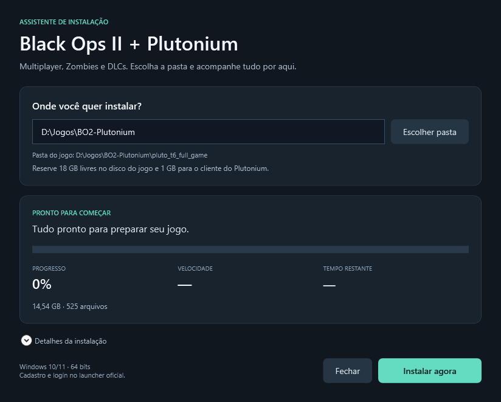

# Instalador BO2 + Plutonium para Windows

Instalador com interface para Windows que baixa e prepara **Black Ops II Multiplayer, Zombies e DLCs** com o Plutonium. Escolha a pasta e acompanhe o progresso geral, a velocidade e o tempo estimado na janela. O jogo tem **14,54 GB**; o ZIP do assistente tem aproximadamente **1,1 MB** e faz o download durante a instalação.



## Baixar e instalar

**[Baixar BO2-Plutonium.zip](https://github.com/guhttps/bo2-plutonium-instalador/releases/latest/download/BO2-Plutonium.zip)**

1. Baixe o ZIP pelo link acima e extraia todos os arquivos.
2. Abra `INSTALAR.cmd` com dois cliques.
3. Na janela, clique em **Escolher pasta** ou digite o destino. Clique em **Instalar agora**.
4. Acompanhe o download e a verificação. Se o Windows pedir autorização para instalar componentes Microsoft ausentes, confirme essa etapa.
5. Ao concluir, clique em **Abrir Plutonium**. Entre com sua própria conta ou [crie uma conta](https://forum.plutonium.pw/register).
6. Escolha **Black Ops 2 Multiplayer** ou **Zombies** e clique em **PLAY**.

O instalador configura a pasta do jogo e cria um atalho na área de trabalho.

## Requisitos

- Windows 10 ou 11 de 64 bits.
- Placa de vídeo compatível com DirectX 11.
- Internet e pelo menos **18 GB livres** no disco do jogo.
- Reserve também **1 GB livre em C:** para o cliente e os componentes.

A campanha não faz parte deste pacote.

## Se o download for interrompido

Na janela, **Interromper** salva o andamento do download. Use **Continuar instalação** ou abra `INSTALAR.cmd` novamente, selecione a **mesma pasta** e inicie a instalação. Os arquivos completos são conferidos e reaproveitados, e as transferências com controle `.aria2` são retomadas. Mantenha esses arquivos de controle enquanto o download estiver incompleto.

A interrupção fica indisponível durante a instalação de componentes e a atualização do cliente. Nessas etapas, aguarde a conclusão. **Detalhes da instalação** mostra o registro do processo se houver um problema.

Se a fonte HTTP estiver indisponível, `ALTERNATIVA-TORRENT.cmd` usa o torrent original. Essa alternativa depende dos participantes da rede BitTorrent e compartilha dados durante o download, com limite de envio de 128 KiB/s; o compartilhamento termina ao concluir.

## Como funciona

O assistente baixa os **525 arquivos** e confere seus hashes. Depois verifica todos os **55.469 blocos** contra o torrent original, prepara os componentes Microsoft ausentes, atualiza o cliente oficial e configura `t6Path`, com backup de uma configuração existente.

O percentual do download soma os bytes de todas as transferências; arquivos já concluídos também entram no total. A verificação tem seu próprio progresso. O tempo restante é uma estimativa baseada na velocidade atual.

O launcher é baixado do fornecedor. Os arquivos do jogo vêm de um arquivo histórico do antigo pacote T6. A origem, os endereços e os hashes estão em [FONTES.txt](BO2-Plutonium/FONTES.txt).

O código do assistente está neste repositório; os dados do jogo são baixados durante a instalação. Este projeto é independente da equipe do Plutonium.

## Pasta de instalação

O jogo fica em:

```text
%USERPROFILE%\Games\BO2-Plutonium\pluto_t6_full_game
```

O assistente guarda o launcher, o cache e os registros em `%LOCALAPPDATA%\BO2-Plutonium-Assistente`. O cliente utiliza `%LOCALAPPDATA%\Plutonium`.

Para usar outro disco, abra o PowerShell na pasta extraída do assistente e execute:

```powershell
powershell.exe -NoProfile -ExecutionPolicy Bypass -File .\instalar.ps1 -PastaJogos "D:\Jogos\BO2-Plutonium"
```

## Validação

Foram verificados o download completo, a integridade de todos os blocos, o fluxo de instalação, a retomada de uma transferência interrompida, o reparo de um arquivo corrompido e a inicialização de Multiplayer e Zombies em LAN com Plutonium r5369.

**Partidas online com amigos ainda não foram testadas.** Cada pessoa precisa fazer login no launcher; a conexão entre jogadores depende da rede de cada PC. A instalação de componentes Microsoft em um Windows limpo também não foi exercitada, pois eles já estavam presentes no PC utilizado.

Confira o [relatório de validação](BO2-Plutonium/VALIDACAO.txt) e as [instruções completas](BO2-Plutonium/LEIA-ME.txt).

Para executar as verificações locais do código, na raiz do repositório:

```powershell
powershell.exe -NoProfile -ExecutionPolicy Bypass -File .\verificar-pacote.ps1
```

Essas verificações usam pequenos arquivos temporários e não executam o jogo.

Para verificar a interface e o acompanhamento do download:

```powershell
powershell.exe -NoProfile -STA -ExecutionPolicy Bypass -File .\verificar-interface.ps1 -Download
```

Esse teste usa um servidor HTTP local com arquivos pequenos, interrompe e retoma a transferência e confere os hashes. Ele baixa apenas o aria2 do projeto oficial caso o programa ainda não esteja no cache; os 14,54 GB do jogo não são baixados pelo teste.
